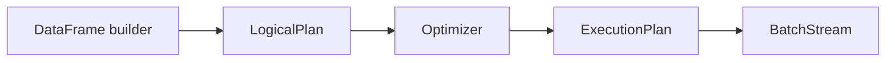
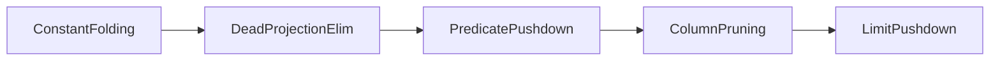

# plume

A query engine in Rust without a SQL frontend. You build query plans by
chaining methods on a `DataFrame`, and `.collect()` runs them. Every query
is checked against DuckDB on the same input, so if `cargo test` is green
the results agree.

```rust
let plan = scan_parquet_auto("fixtures/sales.parquet")?
    .filter(col("price").gt(lit(500.0)))?
    .aggregate(
        vec![col("region")],
        vec![count_star().alias("n"), avg(col("price")).alias("avg_price")],
    )?
    .into_plan();

let batches = collect(&Optimizer::default().optimize(plan)?)?;
```

## What pruning looks like

The 1M-row `sales.parquet` fixture is laid out as 8 row groups of 125,000
rows each, with prices in disjoint bands. When the optimizer pushes
`price > 950` down, only one row group's max value can possibly satisfy
it, so the parquet reader skips the other seven entirely.

```
$ cargo run -p plume-bench --example parquet_filter
=== optimized plan (note pushdown=[(price > 950)] on the scan) ===
Limit: 20
  Filter: (price > 950)
    ParquetScan: fixtures/sales.parquet, projection=[order_id, price], pushdown=[(price > 950)]

scan rows without pushdown: 1000000
scan rows with    pushdown: 125000
(pushdown skipped 7 of 8 row groups; the filter still does the per-row check)
```

The Filter stays in the plan after pushdown because row-group min/max
stats only prove that *no* match exists in a group. They can't prove
that *every* row in the surviving group matches, so per-row filtering
still runs.

## How a query becomes batches



The optimizer is a fixed-point driver over five rules:



Order matters. Predicate pushdown attaches predicate columns to the scan,
which column pruning then has to keep in the projection. Limit pushdown
runs last because it folds into the already-projected scan.

## The optimizer in action

`cargo run -p plume-bench --example optimizer_demo` builds a deliberately
wasteful plan and shows the rules grinding it down:

```
BEFORE:
Limit: 50
  Aggregate: groupBy=[region] aggs=[total_qty, n]
    Filter: (price > (100 + 50))
      Projection: [order_id, category, region, price, quantity]
        ParquetScan: fixtures/sales.parquet [5 cols]

AFTER:
Limit: 50
  Aggregate: groupBy=[region] aggs=[total_qty, n]
    Filter: (price > 150)
      ParquetScan: fixtures/sales.parquet, projection=[region, price, quantity], pushdown=[(price > 150)]
```

Four rules fired. ConstantFolding evaluated `100 + 50` at plan time.
DeadProjectionElim removed the SELECT-* projection. PredicatePushdown
attached `(price > 150)` to the scan. ColumnPruning dropped `order_id`
and `category` from the read. LimitPushdown sat out because an Aggregate
sits between the Limit and the Scan, and aggregates change row count, so
folding the limit past it would silently change the query's meaning.

## What's missing

- No SQL parser. Plans are Rust. The engine is the part worth building.
- No joins.
- The hash GROUP BY is row-at-a-time. Vectorizing it (hashing whole
  columns instead of one row at a time) is the next obvious win.
  `docs/perf.md` has the writeup of where the time actually goes.

168 tests, every pipeline diff-tested against DuckDB.

## Run it

```sh
cargo build --workspace                                # ~3-5 min cold (bundled DuckDB)
cargo run -p plume-bench --bin gen_fixtures            # 10K-row CSV + 1M-row parquet
cargo test --workspace
cargo run -p plume-bench --example optimizer_demo      # or csv_aggregate / parquet_filter / group_by_pipeline
```

For benchmark methodology and how to interpret `cargo bench` output, see
[`docs/perf.md`](docs/perf.md).
