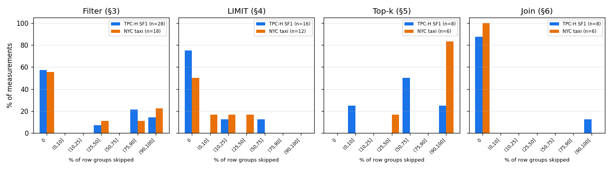
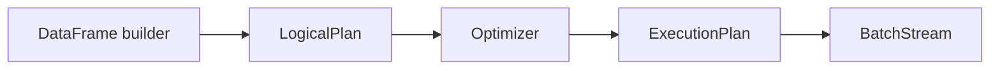

# plume

A query engine in Rust, built to measure how much of a Parquet file
row-group pruning lets you skip on real data. Queries are plans built by
chaining methods on a `DataFrame`. `.collect()` runs them. Every
result is checked against DuckDB on the same input.

```rust
let plan = scan_parquet_auto("data/taxi/trips_sorted.parquet")?
    .filter(col("fare_amount").gt(lit(20.0)))?
    .sort(vec![col("tpep_pickup_datetime").desc()])?
    .limit(100)
    .into_plan();

let batches = collect(&Optimizer::default().optimize(plan)?)?;
```

About 21,000 lines of Rust across five crates. 349 tests, no clippy
warnings.

## What it found

plume implements the four pruning techniques from the
[Snowflake pruning paper](https://arxiv.org/abs/2504.11540) (Zimmerer et
al. 2025). It runs them on TPC-H SF1 and six months of NYC taxi trips,
each written in several layouts.

- **Layout decides almost everything.** For a ~1% range filter on the
  date column, the sorted layout skipped 98% of bytes (TPC-H 48/49 row
  groups, taxi 156/159). The shuffled layout skipped 0%. With pruning,
  queries ran 1.6x to 71.7x faster (`taxi_pickup_0.1pct`: 204 ms →
  2.8 ms).
- **Top-k pruning is the big win.** `ORDER BY ... LIMIT k` skipped a mean
  of 88.2% of row groups on taxi and 67.0% on TPC-H.
  `taxi_topk_pickup_100` went from 1478 ms to 7.2 ms (204.6x).
- **Join pruning needs the right layout and exact keys.** It skipped
  nothing until lineitem was sorted on the join key. Even then, min/max
  alone was too coarse for one customer's orders: 10/49 groups skipped.
  Sending the exact key set made that 43/49, and the query went from
  226 ms to 44 ms.
- **LIMIT pruning's skip counter overstates it.** In a scan that stops
  early, the groups it "skips" would never have been read. What it
  actually changes is which group gets read first. That cut rows decoded
  by up to 15x, but row groups read stayed the same.
- **TPC-H doesn't always understate pruning.** Top-k skipped less on
  TPC-H than on taxi, as the paper says (§8.3). Filter pruning skipped
  more on TPC-H (mean 47.2% vs 37.4% on shared layouts).

Full write-ups, with charts and every measurement:

- [`docs/results-phase1.md`](docs/results-phase1.md): filter pruning,
  by layout and selectivity.
- [`docs/results-phase2.md`](docs/results-phase2.md): LIMIT, top-k and
  join pruning, TPC-H vs taxi.

Both are generated from the CSVs in `results/` by `scripts/report.py`.
No number in either was typed by hand.



## The four pruning techniques

All four use the min/max statistics Parquet keeps per row group and
column. They decide which row groups to skip before decoding them.

**Filter (§3).** The optimizer pushes predicates into the scan. Groups
whose stats prove no row can match are skipped. Each surviving group is
also classified as a full or partial match. The Filter stays in the plan
anyway, because stats prove that *no* row matches. They can't prove that
*every* row matches unless the group is a full match.
(`crates/plume-exec/src/pruning.rs`)

**LIMIT (§4).** `LimitPushdown` folds a Limit into the scan when only
row-preserving nodes sit between them. When a Filter is in the way,
`LimitPruning` gives the scan a `limit_hint` instead. The scan then reads
fully matching groups first. If those already hold k rows, it skips the
rest. The hint is only set when every Filter is covered by the scan's
pushdown predicates. Otherwise a "full match" group might not really
pass.

**Top-k (§5).** `SortLimitToTopK` turns `Sort → Limit` into a `TopKExec`
that shares a boundary with the scan. The scan reads groups best-first.
Once the heap holds k rows, it skips any group whose every value is
strictly worse than the current k-th row. Ties are never skipped. Stats
initialization (§5.4) can set a boundary before anything is read, using
groups that are known full matches. (`crates/plume-exec/src/topk_pruning.rs`)

**Join (§6).** `HashJoinExec` drains its build side before it opens the
probe side. The build keys are therefore known when the probe scan
plans its reads. The join publishes the keys' range, or the exact set if
there are at most 1,024 distinct keys. The scan skips groups no key can
fall into. This is only wired up for Inner, Semi and Right joins, which
drop unmatched probe rows. (`crates/plume-exec/src/join_pruning.rs`)

## How correctness is checked

### Against DuckDB, query by query

`assert_matches_duckdb(plume_output, sql, ...)` registers the same files
as DuckDB views and runs the SQL. Both results are rendered to a
canonical row-of-strings form before comparing. That rendering avoids
three kinds of false mismatch:

- Floats are rendered to about 10 significant digits. That absorbs
  summation-order drift on million-row SUM/AVG.
- Dictionary-encoded and plain strings render the same.
- Schema metadata is ignored.

GROUP BY results are sorted before comparing.

LIMIT and top-k answers aren't unique when rows tie. Those results are
checked by row count, or the sort columns row by row. Each returned row
must also appear in DuckDB's unlimited result, with multiplicity. That
containment check is a join from plume's rows to DuckDB's. It is
deliberately not `EXCEPT ALL`, which spilled gigabytes to disk on the
taxi data.

Every pruning benchmark checks its answer with the technique off and
again with it on.

### Randomized differential testing

`crates/plume-bench/src/random_plans.rs` builds a random plan from a
seed. It generates the plan and the matching SQL side by side: filters,
projections, aggregates, the six join types, sorts, and limits. The
input is small generated Parquet tables with NULLs, dates and
timestamps.

Each case runs in three modes:
- unoptimized,
- optimized,
- optimized with runtime pruning off.

Each mode's result is diffed against DuckDB.

```sh
cargo run --release -p plume-bench --bin fuzz -- --cases 10000
cargo run -p plume-bench --bin fuzz -- --seed 1234          # replay one seed
```

`fuzz --real tpch|taxi` runs the same generator over the real datasets
and their layouts. Its literals are sampled from each column's actual
values, so filters really select something. A quarter of its cases are
shaped to trigger LIMIT, top-k or join pruning. On 60 seeds each, every
case passed, and all four techniques fired on TPC-H.

A failing case is shrunk before it's reported:
1. Steps of the plan are dropped one at a time.
2. Table rows are cut in halving chunks (ddmin).

A cut is kept only if the case still fails the same way. `--save <dir>`
writes the minimal tables and SQL to disk.

The fuzzer found four real bugs:
- GROUP BY on empty input,
- GROUP BY on Date32/Timestamp keys,
- MIN/MAX on timestamps,
- a panic where an error belonged.

Each is now pinned in `tests/random_plan_regressions.rs`.

DuckDB runs with its debug assertions on, in tests and in CI.

### Test counts

```
plume-bench       DuckDB diffs, fuzz, shrinking, harness    158
plume-exec        operators, pruning, evaluator, aggs        95
plume-optimizer   rules, driver, join pushdown               69
plume-core        DataFrame builder, schema math             27
                                                            ---
                                                            349
```

## How a query becomes batches



The optimizer applies seven rules in order. It repeats the full pass
until the plan stops changing, up to 8 passes:


Order matters. Predicate pushdown attaches predicate columns to the
scan, and column pruning then has to keep them in the projection. The
fixed point lets rules feed each other. Take `Limit → Projection →
Scan`:
1. ColumnPruning narrows the scan.
2. DeadProjectionElim drops the now-redundant Projection.
3. LimitPushdown folds the limit into the scan.

No single rule reaches that plan alone.

`cargo run -p plume-bench --example optimizer_demo`:

```
BEFORE:
Limit: 50
  Aggregate: groupBy=[region] aggs=[total_qty, n]
    Filter: (price > (100 + 50))
      Projection: [order_id, category, region, price, quantity]
        ParquetScan: fixtures/sales.parquet [5 cols]

AFTER:
Limit: 50
  Aggregate: groupBy=[region] aggs=[total_qty, n]
    Filter: (price > 150)
      ParquetScan: fixtures/sales.parquet, projection=[region, price, quantity], pushdown=[(price > 150)]
```

The Limit stays above the Aggregate. Aggregates change the row count, so
taking 50 rows from the scan would change the answer.

On the 1M-row `sales.parquet` fixture, prices fall in disjoint bands,
one band per row group. `price > 950` therefore skips 7 of 8 groups.
This is a best case by construction. The real-data numbers are above.

```
$ cargo run -p plume-bench --example parquet_filter
Limit: 20
  Filter: (price > 950)
    ParquetScan: fixtures/sales.parquet, projection=[order_id, price], pushdown=[(price > 950)], limit_hint=20

row groups pruned: 7 of 8
bytes read:        2172299 of 17378825
```

## Joins

Six equi-join shapes (Inner, Left, Right, Full, Semi, Anti) run on one
`HashJoinExec`, plus a cross join. The join builds a hash table from the
right input and probes it with the left. NULL keys never go in the
table. Outer joins track which build rows matched, then emit the
unmatched ones padded with NULLs.

The optimizer knows when *not* to push a predicate through a join.
Take a LEFT JOIN with `WHERE amount > 500` above it, where `amount`
comes from the right side:
- Above the join, `amount` is NULL on unmatched rows, so the filter
  drops them.
- Pushed below the join, the filter would change which rows go
  unmatched, so it stays put.

The pushdown rules for each join type are a table in the doc comment on
`push_filter_through_join`, in
[`crates/plume-optimizer/src/lib.rs`](crates/plume-optimizer/src/lib.rs).
`cargo run -p plume-bench --example join_demo` shows both cases.

## How nulls work

`AND` and `OR` use Arrow's Kleene kernels. All nine
`(true/false/NULL)²` combinations are diffed against DuckDB. Comparisons
propagate NULL the same way: `NULL > 5` is `NULL`, not `false`.

## The crates

`plume-core` (~2,000 lines). `LogicalPlan`, `Expr`, the `DataFrame`
builder and type checking when the plan is built. Every node knows its
output schema. Join schemas concatenate left then right. Clashing names
get a suffix (`id`, `id_1`). Columns become nullable on any side an
outer join can pad with NULLs.

`plume-exec` (~6,800 lines). Operators:
- CSV and Parquet scans,
- filter, projection, limit,
- global and hash-grouped aggregates,
- sort and top-k,
- hash join and cross join.

Pruning lives in this crate: filter classification, the LIMIT hint, the
top-k boundary and the join filter. So do the per-scan metrics the
benchmarks read: groups skipped per technique, bytes read and rows
decoded. Column names are resolved to indices once, so the per-batch
loop never looks up a name. An opt-in `ParallelParquetScanExec` reads
row groups on rayon. The planner never picks it, because it returns
batches out of order.

`plume-optimizer` (~2,900 lines). The seven rules and the fixed-point
driver.

`plume-io` (31 lines). Reads a Parquet file's schema so you can write
`scan_parquet_auto(path)`.

`plume-bench` (~9,200 lines). The DuckDB diff harness, both fuzzers and
the shrinker. Also the dataset preparation, the pruning benchmark,
fixtures, criterion benches and demos.

## What's missing

- **No SQL parser.** Plans are written in Rust. The fuzzer and the
  harness write the SQL side for DuckDB.
- **No qualified columns or self-joins.** Name clashes in a join get
  a numeric suffix.
- **No sort-merge join, no spilling, no join reordering.** Joins run in
  the order you write them.
- **Single-threaded by default.** The benchmarks compare plume on one
  thread against DuckDB on eight. DuckDB is a reference point there, not
  a competitor.
- **Row-at-a-time hash GROUP BY.** The faster per-batch design is
  written up in [`docs/perf.md`](docs/perf.md).
- **No DECIMAL.** `prepare_datasets` casts DECIMAL money columns to
  DOUBLE and records which ones in `data/manifest.json`.
- **NaN.** Parquet leaves NaN out of min/max. NaN in a float column can
  therefore make filter or top-k pruning skip a group it shouldn't. A
  NaN bound in the stats disables pruning for that group.
- **`NotEq` never prunes.** Stats can't cheaply prove that a whole group
  equals one value.
- **Join pruning never fired on taxi.** No taxi layout clusters trips by
  location ID, so every row group spans nearly every zone, and even an
  exact key set can't skip one.

## Run it

```sh
cargo build --workspace                                        # ~3-5 min cold (bundled DuckDB)
cargo run -p plume-bench --bin gen_fixtures                    # small fixtures for tests and demos
cargo test --workspace                                         # 349 tests
cargo run -p plume-bench --example join_demo                   # or optimizer_demo, parquet_filter, group_by_pipeline, csv_aggregate

cargo run --release -p plume-bench --bin prepare_datasets      # TPC-H SF1 + NYC taxi Jan-Jun 2023 into data/ (gitignored)
cargo run --release -p plume-bench --bin prune_bench           # filter pruning -> results/phase1/
cargo run --release -p plume-bench --bin prune_bench -- --phase 2   # all four techniques -> results/phase2/
python3 scripts/report.py                                      # regenerates docs/results-*.md (needs pandas, matplotlib)

cargo run --release -p plume-bench --bin fuzz -- --cases 10000         # random plans vs DuckDB
cargo run --release -p plume-bench --bin fuzz -- --real tpch --cases 200   # same, on the real data
```

[`docs/perf.md`](docs/perf.md) covers benchmark methodology and
`cargo bench`.

## Where the interesting code lives

- `crates/plume-exec/src/pruning.rs`: filter pruning, which decides per
  row group whether nothing, something or everything matches.
- `crates/plume-exec/src/topk_pruning.rs`: the top-k boundary, plus a
  proof sketch of why skipping is safe and of stats initialization.
- `crates/plume-exec/src/join_pruning.rs`: build-side key ranges and
  sets, and which join types may use them.
- `crates/plume-optimizer/src/lib.rs`: the seven rules. The
  `LimitPruning` comment explains when a LIMIT hint is safe.
- `crates/plume-bench/src/random_plans.rs`: the plan/SQL generator and
  the shrinker.
- `crates/plume-bench/src/harness.rs`: the DuckDB diff harness and the
  containment check.
- `crates/plume-exec/src/join.rs`: `HashJoinExec` for all six shapes,
  and where it publishes the join filter.
