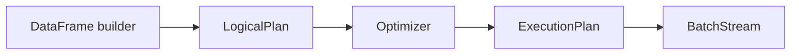
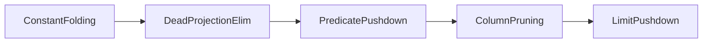

# plume

A query engine in Rust without a SQL frontend. You build query plans by
chaining methods on a `DataFrame`, and `.collect()` runs them. Every query
is checked against DuckDB on the same input, so if `cargo test` is green
the results agree.

```rust
let plan = scan_parquet_auto("fixtures/sales.parquet")?
    .filter(col("price").gt(lit(500.0)))?
    .aggregate(
        vec![col("region")],
        vec![count_star().alias("n"), avg(col("price")).alias("avg_price")],
    )?
    .into_plan();

let batches = collect(&Optimizer::default().optimize(plan)?)?;
```

About 3,400 lines of Rust across five crates, 168 tests, no warnings.

## What pruning looks like

The 1M-row `sales.parquet` fixture is laid out as 8 row groups of 125,000
rows each, with prices in disjoint bands. When the optimizer pushes
`price > 950` down, only one row group's max value can possibly satisfy
it, so the parquet reader skips the other seven entirely.

```
$ cargo run -p plume-bench --example parquet_filter
=== optimized plan (note pushdown=[(price > 950)] on the scan) ===
Limit: 20
  Filter: (price > 950)
    ParquetScan: fixtures/sales.parquet, projection=[order_id, price], pushdown=[(price > 950)]

scan rows without pushdown: 1000000
scan rows with    pushdown: 125000
(pushdown skipped 7 of 8 row groups; the filter still does the per-row check)
```

The Filter stays in the plan after pushdown because row-group min/max
stats only prove that *no* match exists in a group. They can't prove
that *every* row in the surviving group matches, so per-row filtering
still runs.

## How nulls work

SQL's three-valued logic is the kind of thing you get wrong if you write
your own kernel loops. plume delegates to Arrow's `boolean::and_kleene`
and `boolean::or_kleene` for `AND` and `OR`, then diffs the result
against DuckDB on every truth-table combination:

| a     | b     | a AND b | a OR b |
|-------|-------|---------|--------|
| true  | true  | true    | true   |
| true  | NULL  | NULL    | true   |
| false | NULL  | false   | NULL   |
| NULL  | NULL  | NULL    | NULL   |

The evaluator's tests run all nine `(true/false/NULL)^2` combinations
through both engines. Comparisons against literals propagate nulls the
same way: `NULL > 5` is `NULL`, not `false`.

## How a query becomes batches



The optimizer is a fixed-point driver over five rules:



Order matters. Predicate pushdown attaches predicate columns to the scan,
which column pruning then has to keep in the projection. Limit pushdown
runs last because it folds into the already-projected scan.

## The optimizer in action

`cargo run -p plume-bench --example optimizer_demo` builds a deliberately
wasteful plan and shows the rules grinding it down:

```
BEFORE:
Limit: 50
  Aggregate: groupBy=[region] aggs=[total_qty, n]
    Filter: (price > (100 + 50))
      Projection: [order_id, category, region, price, quantity]
        ParquetScan: fixtures/sales.parquet [5 cols]

AFTER:
Limit: 50
  Aggregate: groupBy=[region] aggs=[total_qty, n]
    Filter: (price > 150)
      ParquetScan: fixtures/sales.parquet, projection=[region, price, quantity], pushdown=[(price > 150)]
```

Four rules fired. ConstantFolding evaluated `100 + 50` at plan time.
DeadProjectionElim removed the SELECT-* projection. PredicatePushdown
attached `(price > 150)` to the scan. ColumnPruning dropped `order_id`
and `category` from the read. LimitPushdown sat out because an Aggregate
sits between the Limit and the Scan, and aggregates change row count, so
folding the limit past it would silently change the query's meaning.

There's a fifth case worth seeing: with a plan shaped
`Limit -> Projection -> Scan`, ColumnPruning narrows the scan,
DeadProjectionElim then drops the now-redundant Projection, and finally
LimitPushdown folds the limit into the scan. Three rules cooperate to
reach a state none of them produce in isolation. That's why the driver
runs in a fixed point rather than a single sequential pass.

## A grouped query end to end

```
$ cargo run -p plume-bench --example group_by_pipeline
+--------+-------------+-------+-----------+-------------------+--------------------+-------------------+
| region | category    | n     | total_qty | avg_price         | min_price          | max_price         |
+--------+-------------+-------+-----------+-------------------+--------------------+-------------------+
| west   | garden      | 24971 |    248940 | 749.6730057611747 | 500.0315956713758  | 999.9811564049711 |
| north  | toys        | 24877 |    248949 | 750.7933018230428 | 500.02438141010185 | 999.9966163968268 |
| east   | electronics | 25366 |    254022 | 750.9629128771891 | 500.0075740129966  | 999.9930958184789 |
| ...    | ...         | ...   | ...       | ...               | ...                | ...               |
+--------+-------------+-------+-----------+-------------------+--------------------+-------------------+
```

The plan is `scan -> filter (price > 500) -> aggregate by (region, category)
with COUNT/SUM/AVG/MIN/MAX`. The optimizer turns the scan into
`projection=[category, region, price, quantity], pushdown=[(price > 500)]`,
so half the row groups are skipped and only four columns are decoded.
Twenty distinct (region, category) groups come out, each with five
aggregates per row. DuckDB returns the same numbers when given the same
parquet, modulo summation-order drift past the 10th significant digit.

## The crates

`plume-core` (~720 lines). `LogicalPlan` and `Expr` enums, the
`DataFrame` builder, schema-time type checking. Every plan node knows
its output schema. Aggregate nodes reject non-aggregate expressions in
agg position at plan-build time, before anything runs.

`plume-exec` (~1,800 lines). The execution side. `ExecutionPlan` trait
returning a `Box<dyn Iterator<Item = Result<RecordBatch>> + Send>`,
operators for CSV/Parquet scans, filter, projection, limit, global and
hash-grouped aggregates. The compiled-expression hot path lives here:
column names get resolved to indices once at operator construction so
the per-batch loop is a vec lookup instead of a HashMap probe. Opt-in
`ParallelParquetScanExec` reads row groups in parallel via rayon.

`plume-optimizer` (~600 lines). The five-rule pipeline plus the
fixed-point driver. Each rule implements a small `OptimizerRule` trait
(`name()` and `rewrite(plan) -> Result<plan>`). The driver runs the
list to convergence with a hard cap of 8 passes so a misbehaving rule
that flip-flops doesn't loop forever.

`plume-io` (30 lines). One file. Reads parquet metadata to produce a
`SchemaRef`, then constructs a `DataFrame` rooted at a Parquet scan.
This is the bridge that lets the diff harness write
`scan_parquet_auto(path)` instead of spelling out five `Field`s.

`plume-bench`. Diff harness, fixture generator, criterion benches,
runnable demos. The harness is the load-bearing piece for correctness
(see below).

## How correctness is checked

The harness signature is `assert_matches_duckdb(plume_output, sql,
csv_files, parquet_files, order_sensitive)`. It registers the named
files as DuckDB views, runs the SQL, pulls the result back as Arrow
batches, and renders both sides to a canonical row-of-strings form
before comparing. The string form sidesteps three classes of fake
mismatches:

- Float values with different bit patterns that print identically.
  Floats render in scientific notation with about 10 significant
  digits, which absorbs summation-order drift on million-row SUM/AVG
  without making genuinely different values look the same.
- Dictionary-encoded vs plain string arrays. Both render to the
  same string.
- Schema metadata (field nullability flags, PARQUET annotations).
  Ignored by the renderer.

`order_sensitive=false` sorts both sides before comparing, used for
GROUP BY queries where hash-table iteration order is undefined.

Of the 168 tests, 68 go through this harness end-to-end against
DuckDB. The other 100 are unit tests (operator behavior, plan-tree
structure, optimizer rewrites, accumulator math) where DuckDB
agreement isn't the point.

```
plume-bench    diff harness tests vs DuckDB        68
               (filter, project, aggregate, group, prune, pushdown)
plume-bench    arrow fluency / harness sanity      3
plume-core     DataFrame builder + schema math     12
plume-exec     operators, evaluator, aggregates    53
plume-optimizer rules + driver                     32
                                                  ---
                                                   168
```

## Parallel scan

```rust
use plume_exec::{ExecutionPlan, ParallelParquetScanExec};

let scan = ParallelParquetScanExec::new(path, schema)
    .with_pushdown_predicates(vec![col("price").gt(lit(500.0))])
    .with_max_workers(4);
let stream = scan.execute()?;
```

Each surviving row group becomes a rayon task. Workers stream batches
back through an `mpsc` channel, so the foreground iterator pulls them
out in completion order, not file order. Filter / aggregate /
projection don't care about input order. Limit does. The planner
never picks this scan automatically for that reason; you opt in if
you know your downstream operators are order-insensitive.

The pushdown predicate is honoured per-worker: each task reads only
its assigned row groups via `with_row_groups(vec![idx])`, so if
upstream pruning already eliminated half the row groups, the
parallel scan only spawns tasks for the other half.

## What's missing

No SQL parser. Plans are Rust. The engine is the part worth building
and SQL parsers are well-trod ground.

No joins. Out of scope.

The hash GROUP BY is row-at-a-time. Each row gets hashed into a key
`Vec<KeyValue>`, looked up in a `HashMap`, and the per-aggregate
accumulators are updated with a 1-row sliced `RecordBatch`. The
faster path is to evaluate group keys for the whole batch up front,
build a `HashMap<key, Vec<row_index>>` once per batch, then call each
accumulator's `update_batch` on the indexed sub-batch. For
low-cardinality groupings (the common case) the speedup is large. The
writeup is in [`docs/perf.md`](docs/perf.md).

`NotEq` predicates don't prune row groups even in principle. Stats
can prove `col != lit` is always false only if the entire row group
equals `lit`, which they don't track cheaply. The optimizer collects
the predicate but the row-group filter ignores `NotEq`.

Float `NaN` in row-group min/max disables pruning for that group.
Comparing against `NaN` returns `false` for every operator, so a
`NaN` bound would silently skip groups that should have been kept.

## Run it

```sh
cargo build --workspace                            # ~3-5 min cold (bundled DuckDB)
cargo run -p plume-bench --bin gen_fixtures        # 10K-row CSV + 1M-row parquet
cargo test --workspace                             # 168 tests
cargo run -p plume-bench --example optimizer_demo  # or csv_aggregate / parquet_filter / group_by_pipeline
```

For benchmark methodology and how to interpret `cargo bench` output,
see [`docs/perf.md`](docs/perf.md).

## Where the interesting code lives

Things worth reading in order:

- `crates/plume-core/src/expr.rs`: the `Expr` enum, type resolution,
  and the strict same-type comparison rule that rejects bad plans
  before they execute.
- `crates/plume-exec/src/aggregate.rs`: the `Accumulator` trait,
  six concrete impls, and the `HashAggregateExec` row-at-a-time
  group-by loop with the `KeyValue` enum that handles NULL keys.
- `crates/plume-optimizer/src/lib.rs`: all five rules in one file,
  including the fixed-point driver. Reading top to bottom is the
  fastest way to understand what optimization passes actually look
  like.
- `crates/plume-exec/src/operators.rs`: the `row_group_can_satisfy`
  function with the per-operator pruning rules. The `Eq` case is one
  line, the rest are similar.
- `crates/plume-bench/src/harness.rs`: the diff harness. About 165
  lines, including the canonical-row renderer.
