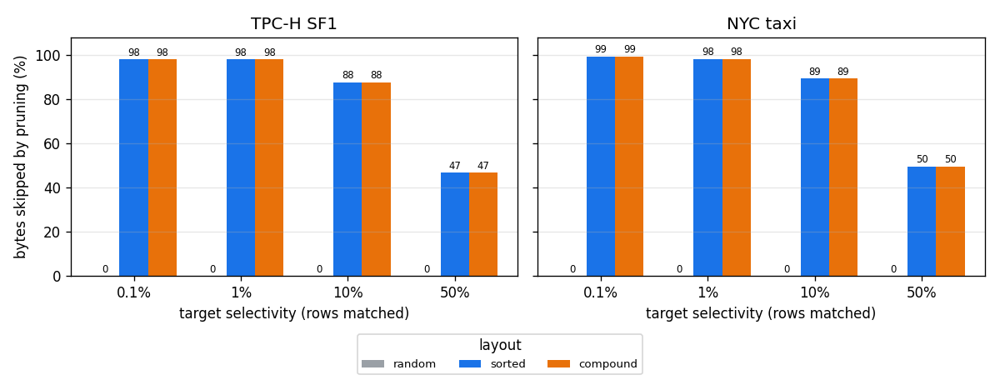
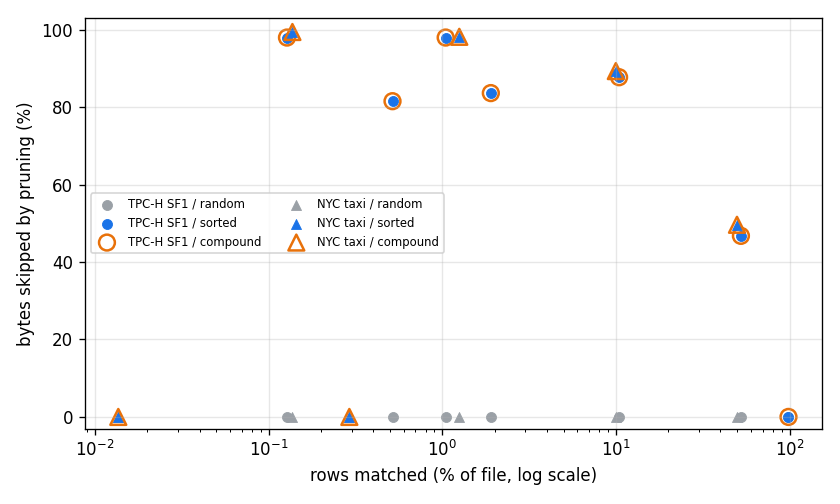
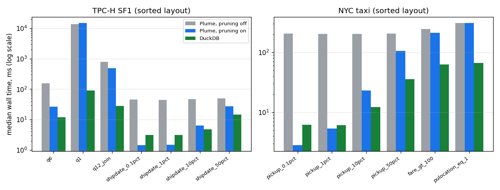

# Phase 1 results: row-group pruning on real data

<!-- Generated by scripts/report.py from results/phase1/. Don't edit by hand. -->

How much of a Parquet file does min/max row-group pruning skip on real data, how much does the layout change that, and does TPC-H understate it the way the Snowflake paper reports ([Zimmerer et al. 2025](https://arxiv.org/abs/2504.11540), §8.3)?

Data: TPC-H SF1 `lineitem` and NYC yellow taxi trips (Jan–Jun 2023), each written shuffled (`random`), sorted on the date column (`sorted`), and sorted on the date plus a second column (`compound`). Every file uses the same row-group size. See `crates/plume-bench/src/bin/prepare_datasets.rs` and `crates/plume-bench/src/workloads.rs`.

Run: 2026-11-15T06:08:51Z on Apple M2 (8 cores), rustc 1.95.0 (59807616e 2026-04-14), DuckDB v1.2.2, commit `c7c10d8`. Median of 5 runs after 1 warm-up. Plume is single-threaded; DuckDB used 8 threads.

Every Plume result was checked against DuckDB's, with pruning both on and off.

## Findings

- **TPC-H SF1, ~1% of rows** (`tpch_shipdate_1pct`, actual 1.0%): the sorted layout skipped 98.0% of bytes (48/49 row groups), compound 98.0%, random 0.0%.
- **NYC taxi, ~1% of rows** (`taxi_pickup_1pct`, actual 1.3%): the sorted layout skipped 98.1% of bytes (156/159 row groups), compound 98.1%, random 0.0%.
- **Random layout:** the most any query skipped was 0.0% of bytes, across all 13 random-layout measurements.
- **TPC-H spec queries** (Q1, Q6, Q12-style) match 0.5%–98.6% of lineitem rows. On the sorted layout they skipped 0.0%–83.6% of bytes.
- **Correlated column:** Q12 filters on `l_receiptdate`, which no layout sorts on, but it tracks `l_shipdate`. On the shipdate-sorted file it still skipped 81.5% of lineitem bytes.
- **Unsorted column:** `fare_amount > 100` (actual 0.3% of rows) skipped 0.0% / 0.0% / 0.0% of bytes on random / sorted / compound.
- **Point lookup:** `PULocationID = 1` (actual 0.014% of rows) skipped 0.0% / 0.0% / 0.0% of bytes on random / sorted / compound. Compound only sorts on `PULocationID` within equal pickup timestamps.
- **Highly selective ranges** (~0.1% target) on the sorted layout skipped 98.0% of bytes on TPC-H and 99.4% on taxi.
- **Row-group granularity:** one row group is 2.0% of `lineitem` and 0.6% of `trips`, so a query that touches any rows reads at least that much. Ranges narrower than one row group can't skip more.
- **Time:** on the sorted layout, for the 10 queries where pruning skipped anything, Plume's median time dropped 1.6x to 71.7x (largest: `taxi_pickup_0.1pct`, 204 ms → 2.8 ms).
- **Timing noise:** on the random layout nothing is pruned, so off and on do the same work. Their medians differ by up to 0.8%, which is a rough measure of timing noise on this machine. Byte and row-group counts don't vary between runs.
- **DuckDB** (8 threads) was faster than Plume with pruning on (1 thread) in 31 of 39 measurements. It is here as a reference point, not a competitor.

## Bytes skipped by layout and selectivity



## Selectivity vs. bytes skipped, every query



## Time



## All measurements (pruning on)

Bytes are compressed column-chunk bytes for the columns the query reads, in the fact table (`lineitem` / `trips`). Rows decoded is what the Parquet reader produced before Plume's filter ran.

| dataset | query | target | actual | layout | row groups skipped | bytes skipped | rows decoded |
|---|---|---|---|---|---|---|---|
| tpch | `tpch_q1` |  | 98.6% | random | 0/49 | 0.0% | 6,001,215 |
| tpch | `tpch_q1` |  | 98.6% | sorted | 0/49 | 0.0% | 6,001,215 |
| tpch | `tpch_q1` |  | 98.6% | compound | 0/49 | 0.0% | 6,001,215 |
| tpch | `tpch_q12_join` |  | 0.5% | random | 0/49 | 0.0% | 6,001,215 |
| tpch | `tpch_q12_join` |  | 0.5% | sorted | 40/49 | 81.5% | 1,107,070 |
| tpch | `tpch_q12_join` |  | 0.5% | compound | 40/49 | 81.5% | 1,107,070 |
| tpch | `tpch_q6` |  | 1.9% | random | 0/49 | 0.0% | 6,001,215 |
| tpch | `tpch_q6` |  | 1.9% | sorted | 41/49 | 83.6% | 984,190 |
| tpch | `tpch_q6` |  | 1.9% | compound | 41/49 | 83.6% | 984,190 |
| tpch | `tpch_shipdate_0.1pct` | 0.1% | 0.1% | random | 0/49 | 0.0% | 6,001,215 |
| tpch | `tpch_shipdate_0.1pct` | 0.1% | 0.1% | sorted | 48/49 | 98.0% | 122,880 |
| tpch | `tpch_shipdate_0.1pct` | 0.1% | 0.1% | compound | 48/49 | 98.0% | 122,880 |
| tpch | `tpch_shipdate_10pct` | 10.0% | 10.4% | random | 0/49 | 0.0% | 6,001,215 |
| tpch | `tpch_shipdate_10pct` | 10.0% | 10.4% | sorted | 43/49 | 87.7% | 737,855 |
| tpch | `tpch_shipdate_10pct` | 10.0% | 10.4% | compound | 43/49 | 87.7% | 737,855 |
| tpch | `tpch_shipdate_1pct` | 1.0% | 1.0% | random | 0/49 | 0.0% | 6,001,215 |
| tpch | `tpch_shipdate_1pct` | 1.0% | 1.0% | sorted | 48/49 | 98.0% | 122,880 |
| tpch | `tpch_shipdate_1pct` | 1.0% | 1.0% | compound | 48/49 | 98.0% | 122,880 |
| tpch | `tpch_shipdate_50pct` | 50.0% | 52.5% | random | 0/49 | 0.0% | 6,001,215 |
| tpch | `tpch_shipdate_50pct` | 50.0% | 52.5% | sorted | 23/49 | 46.7% | 3,197,180 |
| tpch | `tpch_shipdate_50pct` | 50.0% | 52.5% | compound | 23/49 | 46.8% | 3,197,180 |
| taxi | `taxi_fare_gt_100` |  | 0.3% | random | 0/159 | 0.0% | 19,493,620 |
| taxi | `taxi_fare_gt_100` |  | 0.3% | sorted | 0/159 | 0.0% | 19,493,620 |
| taxi | `taxi_fare_gt_100` |  | 0.3% | compound | 0/159 | 0.0% | 19,493,620 |
| taxi | `taxi_pickup_0.1pct` | 0.1% | 0.1% | random | 0/159 | 0.0% | 19,493,620 |
| taxi | `taxi_pickup_0.1pct` | 0.1% | 0.1% | sorted | 158/159 | 99.4% | 122,880 |
| taxi | `taxi_pickup_0.1pct` | 0.1% | 0.1% | compound | 158/159 | 99.4% | 122,880 |
| taxi | `taxi_pickup_10pct` | 10.0% | 10.0% | random | 0/159 | 0.0% | 19,493,620 |
| taxi | `taxi_pickup_10pct` | 10.0% | 10.0% | sorted | 142/159 | 89.3% | 2,090,780 |
| taxi | `taxi_pickup_10pct` | 10.0% | 10.0% | compound | 142/159 | 89.3% | 2,090,780 |
| taxi | `taxi_pickup_1pct` | 1.0% | 1.3% | random | 0/159 | 0.0% | 19,493,620 |
| taxi | `taxi_pickup_1pct` | 1.0% | 1.3% | sorted | 156/159 | 98.1% | 368,640 |
| taxi | `taxi_pickup_1pct` | 1.0% | 1.3% | compound | 156/159 | 98.1% | 368,640 |
| taxi | `taxi_pickup_50pct` | 50.0% | 49.8% | random | 0/159 | 0.0% | 19,493,620 |
| taxi | `taxi_pickup_50pct` | 50.0% | 49.8% | sorted | 79/159 | 49.6% | 9,836,770 |
| taxi | `taxi_pickup_50pct` | 50.0% | 49.8% | compound | 79/159 | 49.6% | 9,836,770 |
| taxi | `taxi_pulocation_eq_1` |  | 0.014% | random | 0/159 | 0.0% | 19,493,620 |
| taxi | `taxi_pulocation_eq_1` |  | 0.014% | sorted | 0/159 | 0.0% | 19,493,620 |
| taxi | `taxi_pulocation_eq_1` |  | 0.014% | compound | 0/159 | 0.0% | 19,493,620 |

## Times

| dataset | query | layout | Plume off (ms) | Plume on (ms) | DuckDB (ms) |
|---|---|---|---|---|---|
| tpch | `tpch_q1` | random | 14104.7 | 14076.3 | 96.4 |
| tpch | `tpch_q1` | sorted | 13869.4 | 14965.7 | 91.0 |
| tpch | `tpch_q1` | compound | 17181.9 | 13812.9 | 130.8 |
| tpch | `tpch_q12_join` | random | 734.2 | 734.7 | 59.4 |
| tpch | `tpch_q12_join` | sorted | 798.4 | 485.1 | 27.8 |
| tpch | `tpch_q12_join` | compound | 749.5 | 459.0 | 25.0 |
| tpch | `tpch_q6` | random | 175.7 | 176.1 | 46.2 |
| tpch | `tpch_q6` | sorted | 155.3 | 26.2 | 12.1 |
| tpch | `tpch_q6` | compound | 123.9 | 20.6 | 11.8 |
| tpch | `tpch_shipdate_0.1pct` | random | 64.1 | 64.0 | 23.7 |
| tpch | `tpch_shipdate_0.1pct` | sorted | 45.8 | 1.4 | 3.1 |
| tpch | `tpch_shipdate_0.1pct` | compound | 42.9 | 1.4 | 3.2 |
| tpch | `tpch_shipdate_10pct` | random | 66.5 | 66.5 | 25.2 |
| tpch | `tpch_shipdate_10pct` | sorted | 47.2 | 6.4 | 4.7 |
| tpch | `tpch_shipdate_10pct` | compound | 43.1 | 5.8 | 5.2 |
| tpch | `tpch_shipdate_1pct` | random | 64.8 | 64.8 | 25.1 |
| tpch | `tpch_shipdate_1pct` | sorted | 44.8 | 1.5 | 3.1 |
| tpch | `tpch_shipdate_1pct` | compound | 43.1 | 1.5 | 3.0 |
| tpch | `tpch_shipdate_50pct` | random | 71.6 | 71.2 | 27.6 |
| tpch | `tpch_shipdate_50pct` | sorted | 50.1 | 27.1 | 14.6 |
| tpch | `tpch_shipdate_50pct` | compound | 43.4 | 23.5 | 11.9 |
| taxi | `taxi_fare_gt_100` | random | 211.4 | 211.4 | 57.3 |
| taxi | `taxi_fare_gt_100` | sorted | 243.3 | 212.2 | 63.0 |
| taxi | `taxi_fare_gt_100` | compound | 209.7 | 209.7 | 55.1 |
| taxi | `taxi_pickup_0.1pct` | random | 224.3 | 224.3 | 72.2 |
| taxi | `taxi_pickup_0.1pct` | sorted | 204.1 | 2.8 | 6.3 |
| taxi | `taxi_pickup_0.1pct` | compound | 201.4 | 2.8 | 6.0 |
| taxi | `taxi_pickup_10pct` | random | 234.3 | 233.5 | 74.9 |
| taxi | `taxi_pickup_10pct` | sorted | 202.9 | 23.2 | 12.3 |
| taxi | `taxi_pickup_10pct` | compound | 202.5 | 23.1 | 12.5 |
| taxi | `taxi_pickup_1pct` | random | 227.0 | 226.9 | 72.8 |
| taxi | `taxi_pickup_1pct` | sorted | 202.7 | 5.3 | 6.2 |
| taxi | `taxi_pickup_1pct` | compound | 202.8 | 5.3 | 6.1 |
| taxi | `taxi_pickup_50pct` | random | 249.7 | 247.5 | 90.5 |
| taxi | `taxi_pickup_50pct` | sorted | 204.4 | 104.9 | 35.8 |
| taxi | `taxi_pickup_50pct` | compound | 204.4 | 104.6 | 36.2 |
| taxi | `taxi_pulocation_eq_1` | random | 314.1 | 313.8 | 75.1 |
| taxi | `taxi_pulocation_eq_1` | sorted | 306.8 | 307.1 | 66.7 |
| taxi | `taxi_pulocation_eq_1` | compound | 307.6 | 307.9 | 67.3 |

## Reproduce

```sh
cargo run --release -p plume-bench --bin prepare_datasets
cargo run --release -p plume-bench --bin prune_bench
python3 scripts/report.py
```
