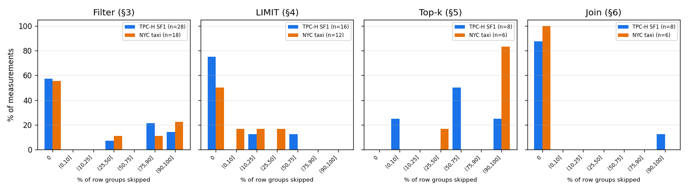
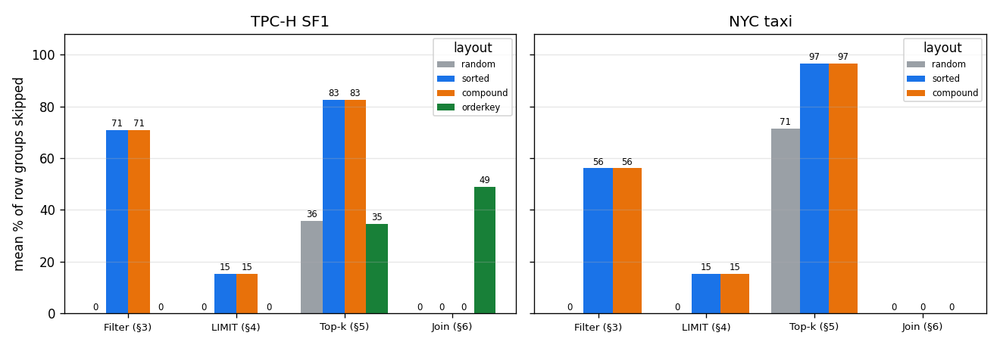

# Phase 2 results: LIMIT, top-k and join pruning

<!-- Generated by scripts/report.py from results/phase2/. Don't edit by hand. -->

Phase 1 measured filter pruning. Phase 2 adds the paper's other three techniques ([Zimmerer et al. 2025](https://arxiv.org/abs/2504.11540), §4–§6) and asks: how much does each skip on TPC-H vs real taxi data, across layouts, and does TPC-H give these techniques few opportunities, as the paper says (§8.3)?

Layouts: `random` = shuffled; `sorted` = sorted on the date column; `compound` = sorted on the date, then a second column; `orderkey` = lineitem sorted on l_orderkey (TPC-H only). Queries: `crates/plume-bench/src/workloads.rs` (`phase2_for_dataset`).

Run: 2026-11-16T04:32:45Z on Apple M2 (8 cores), rustc 1.95.0 (59807616e 2026-04-14), DuckDB v1.2.2, commit `11c60d9`. Median of 5 runs after 1 warm-up. Plume is single-threaded; DuckDB used 8 threads.

Each query ran with its own technique off and on, every other technique left on, and both results were checked against DuckDB. LIMIT and top-k answers aren't unique, so those were checked by row count (or the sort columns, row by row) plus every row being in DuckDB's unlimited result. A technique's "% skipped" is its own counter over the fact table's row groups, so a group filter pruning already removed isn't counted again.

## Findings

- **Filter (§3):** on the three layouts both datasets share, TPC-H skipped more than taxi, the opposite of what §8.3 predicts: mean 47.2% of row groups on TPC-H (12 of 21 measurements skipped anything) vs 37.4% on taxi (8 of 18).
- **LIMIT (§4):** on the three layouts both datasets share, TPC-H and taxi skipped the same amount: mean 10.2% of row groups on TPC-H (4 of 12 measurements skipped anything) vs 10.2% on taxi (6 of 12).
- **Top-k (§5):** on the three layouts both datasets share, TPC-H skipped less than taxi, as §8.3 predicts: mean 67.0% of row groups on TPC-H (6 of 6 measurements skipped anything) vs 88.2% on taxi (6 of 6).
- **Join (§6):** on the three layouts both datasets share, TPC-H and taxi skipped the same amount: mean 0.0% of row groups on TPC-H (0 of 6 measurements skipped anything) vs 0.0% on taxi (0 of 6).
- **LIMIT pruning** planned to skip row groups in 10 of 28 LIMIT measurements, but row groups actually read went from 28 (off) to 28 (on) in total: the Limit operator stops the scan after 100 rows either way, so the groups it "skipped" would never have been reached. What it changes is which group is read first, a fully matching one instead of a partly matching one: rows decoded went down in 8 measurements (up to 15x fewer), up in 0, and the same in the rest. Its skip counter overstates the saving for a single-threaded scan that stops early.
- **Top-k `tpch_topk_extendedprice_10`:** row groups skipped per layout: random 33/49, sorted 33/49, compound 33/49, orderkey 31/49.
- **Top-k `tpch_topk_shipdate_100`:** row groups skipped per layout: random 2/49, sorted 48/49, compound 48/49, orderkey 3/49.
- **Top-k `taxi_topk_fare_10`:** row groups skipped per layout: random 149/159, sorted 149/159, compound 149/159.
- **Top-k `taxi_topk_pickup_100`:** row groups skipped per layout: random 78/159, sorted 158/159, compound 158/159.
- **Join `tpch_join_orderdate_week`:** probe row groups skipped per layout: random 0/49, sorted 0/49, compound 0/49, orderkey 0/49.
- **Join `tpch_join_orderkey_1pct`:** probe row groups skipped per layout: random 0/49, sorted 0/49, compound 0/49, orderkey 48/49.
- **Join `taxi_join_zones_ewr`:** probe row groups skipped per layout: random 0/159, sorted 0/159, compound 0/159.
- **Join `taxi_join_zones_manhattan`:** probe row groups skipped per layout: random 0/159, sorted 0/159, compound 0/159.
- **Time:** in the 25 LIMIT/top-k/join measurements where the technique skipped something, Plume's median time changed by 1.01x to 230.5x (largest: `taxi_topk_pickup_100` on taxi sorted, 1468 ms → 6.4 ms).
- **Timing noise:** where a technique skipped nothing, off and on do the same work. Their medians differ by 0.7% at the median and 141.4% at most (`tpch_limit_50pct` on tpch random: 2.5 ms vs 6.1 ms; very short queries are the noisiest in relative terms).

## Distribution of row groups skipped, per technique

In the style of the paper's Figure 1. One measurement is one query on one layout.



## TPC-H vs taxi

| technique | dataset | measurements | skipped anything | median skipped | mean skipped | max skipped |
|---|---|---|---|---|---|---|
| Filter (§3) | TPC-H SF1 | 28 | 12 | 0.0% | 35.4% | 98.0% |
| Filter (§3) | NYC taxi | 18 | 8 | 0.0% | 37.4% | 99.4% |
| LIMIT (§4) | TPC-H SF1 | 16 | 4 | 0.0% | 7.7% | 51.0% |
| LIMIT (§4) | NYC taxi | 12 | 6 | 0.6% | 10.2% | 49.7% |
| Top-k (§5) | TPC-H SF1 | 8 | 8 | 67.3% | 58.9% | 98.0% |
| Top-k (§5) | NYC taxi | 6 | 6 | 93.7% | 88.2% | 99.4% |
| Join (§6) | TPC-H SF1 | 8 | 1 | 0.0% | 12.2% | 98.0% |
| Join (§6) | NYC taxi | 6 | 0 | 0.0% | 0.0% | 0.0% |

## Which layout each technique depends on

Mean % of row groups skipped.



| technique | dataset | random | sorted | compound | orderkey |
|---|---|---|---|---|---|
| Filter (§3) | TPC-H SF1 | 0.0% | 70.8% | 70.8% | 0.0% |
| Filter (§3) | NYC taxi | 0.0% | 56.1% | 56.1% |  |
| LIMIT (§4) | TPC-H SF1 | 0.0% | 15.3% | 15.3% | 0.0% |
| LIMIT (§4) | NYC taxi | 0.0% | 15.3% | 15.3% |  |
| Top-k (§5) | TPC-H SF1 | 35.7% | 82.7% | 82.7% | 34.7% |
| Top-k (§5) | NYC taxi | 71.4% | 96.5% | 96.5% |  |
| Join (§6) | TPC-H SF1 | 0.0% | 0.0% | 0.0% | 49.0% |
| Join (§6) | NYC taxi | 0.0% | 0.0% | 0.0% |  |

## All measurements

"Row groups read" counts groups the Parquet reader actually decoded rows from, so it also reflects early termination (a Limit or TopK that stops pulling) and the other techniques, which stay on in both modes.

| technique | dataset | query | layout | skipped by technique | row groups read (off → on) | rows decoded (off → on) | Plume ms (off → on) | DuckDB ms |
|---|---|---|---|---|---|---|---|---|
| filter | tpch | `tpch_q1` | random | 0/49 (0.0%) | 49 → 49 | 6,001,215 → 6,001,215 | 14028.4 → 14297.9 | 101.2 |
| filter | tpch | `tpch_q1` | sorted | 0/49 (0.0%) | 49 → 49 | 6,001,215 → 6,001,215 | 14049.2 → 13921.9 | 96.1 |
| filter | tpch | `tpch_q1` | compound | 0/49 (0.0%) | 49 → 49 | 6,001,215 → 6,001,215 | 14162.3 → 13949.1 | 87.0 |
| filter | tpch | `tpch_q1` | orderkey | 0/49 (0.0%) | 49 → 49 | 6,001,215 → 6,001,215 | 14150.0 → 14247.1 | 103.9 |
| filter | tpch | `tpch_q12_join` | random | 0/49 (0.0%) | 49 → 49 | 6,001,215 → 6,001,215 | 752.9 → 735.7 | 63.0 |
| filter | tpch | `tpch_q12_join` | sorted | 40/49 (81.6%) | 49 → 9 | 6,001,215 → 1,105,920 | 752.8 → 461.0 | 27.4 |
| filter | tpch | `tpch_q12_join` | compound | 40/49 (81.6%) | 49 → 9 | 6,001,215 → 1,105,920 | 775.7 → 501.9 | 28.2 |
| filter | tpch | `tpch_q12_join` | orderkey | 0/49 (0.0%) | 49 → 49 | 6,001,215 → 6,001,215 | 709.9 → 708.0 | 57.0 |
| filter | tpch | `tpch_q6` | random | 0/49 (0.0%) | 49 → 49 | 6,001,215 → 6,001,215 | 179.2 → 176.6 | 48.6 |
| filter | tpch | `tpch_q6` | sorted | 41/49 (83.7%) | 49 → 8 | 6,001,215 → 983,040 | 158.5 → 26.5 | 14.1 |
| filter | tpch | `tpch_q6` | compound | 41/49 (83.7%) | 49 → 8 | 6,001,215 → 983,040 | 105.9 → 18.1 | 11.6 |
| filter | tpch | `tpch_q6` | orderkey | 0/49 (0.0%) | 49 → 49 | 6,001,215 → 6,001,215 | 177.1 → 176.4 | 58.0 |
| filter | tpch | `tpch_shipdate_0.1pct` | random | 0/49 (0.0%) | 49 → 49 | 6,001,215 → 6,001,215 | 64.7 → 64.3 | 27.6 |
| filter | tpch | `tpch_shipdate_0.1pct` | sorted | 48/49 (98.0%) | 49 → 1 | 6,001,215 → 122,880 | 42.8 → 1.4 | 3.0 |
| filter | tpch | `tpch_shipdate_0.1pct` | compound | 48/49 (98.0%) | 49 → 1 | 6,001,215 → 122,880 | 45.5 → 1.5 | 3.4 |
| filter | tpch | `tpch_shipdate_0.1pct` | orderkey | 0/49 (0.0%) | 49 → 49 | 6,001,215 → 6,001,215 | 63.8 → 64.1 | 23.2 |
| filter | tpch | `tpch_shipdate_10pct` | random | 0/49 (0.0%) | 49 → 49 | 6,001,215 → 6,001,215 | 73.3 → 68.2 | 27.6 |
| filter | tpch | `tpch_shipdate_10pct` | sorted | 43/49 (87.8%) | 49 → 6 | 6,001,215 → 737,280 | 42.9 → 5.5 | 4.6 |
| filter | tpch | `tpch_shipdate_10pct` | compound | 43/49 (87.8%) | 49 → 6 | 6,001,215 → 737,280 | 43.4 → 5.6 | 5.6 |
| filter | tpch | `tpch_shipdate_10pct` | orderkey | 0/49 (0.0%) | 49 → 49 | 6,001,215 → 6,001,215 | 66.4 → 66.5 | 24.7 |
| filter | tpch | `tpch_shipdate_1pct` | random | 0/49 (0.0%) | 49 → 49 | 6,001,215 → 6,001,215 | 67.4 → 70.7 | 27.5 |
| filter | tpch | `tpch_shipdate_1pct` | sorted | 48/49 (98.0%) | 49 → 1 | 6,001,215 → 122,880 | 42.9 → 1.4 | 3.4 |
| filter | tpch | `tpch_shipdate_1pct` | compound | 48/49 (98.0%) | 49 → 1 | 6,001,215 → 122,880 | 48.9 → 1.5 | 3.4 |
| filter | tpch | `tpch_shipdate_1pct` | orderkey | 0/49 (0.0%) | 49 → 49 | 6,001,215 → 6,001,215 | 64.4 → 64.8 | 23.9 |
| filter | tpch | `tpch_shipdate_50pct` | random | 0/49 (0.0%) | 49 → 49 | 6,001,215 → 6,001,215 | 71.5 → 71.6 | 32.5 |
| filter | tpch | `tpch_shipdate_50pct` | sorted | 23/49 (46.9%) | 49 → 26 | 6,001,215 → 3,194,880 | 43.8 → 22.4 | 11.4 |
| filter | tpch | `tpch_shipdate_50pct` | compound | 23/49 (46.9%) | 49 → 26 | 6,001,215 → 3,194,880 | 43.6 → 22.3 | 11.6 |
| filter | tpch | `tpch_shipdate_50pct` | orderkey | 0/49 (0.0%) | 49 → 49 | 6,001,215 → 6,001,215 | 71.5 → 71.6 | 25.5 |
| filter | taxi | `taxi_fare_gt_100` | random | 0/159 (0.0%) | 159 → 159 | 19,493,620 → 19,493,620 | 211.8 → 211.8 | 66.7 |
| filter | taxi | `taxi_fare_gt_100` | sorted | 0/159 (0.0%) | 159 → 159 | 19,493,620 → 19,493,620 | 209.9 → 209.9 | 61.5 |
| filter | taxi | `taxi_fare_gt_100` | compound | 0/159 (0.0%) | 159 → 159 | 19,493,620 → 19,493,620 | 209.7 → 209.7 | 68.7 |
| filter | taxi | `taxi_pickup_0.1pct` | random | 0/159 (0.0%) | 159 → 159 | 19,493,620 → 19,493,620 | 223.8 → 224.0 | 81.7 |
| filter | taxi | `taxi_pickup_0.1pct` | sorted | 158/159 (99.4%) | 159 → 1 | 19,493,620 → 122,880 | 201.6 → 2.8 | 6.7 |
| filter | taxi | `taxi_pickup_0.1pct` | compound | 158/159 (99.4%) | 159 → 1 | 19,493,620 → 122,880 | 202.7 → 2.9 | 6.5 |
| filter | taxi | `taxi_pickup_10pct` | random | 0/159 (0.0%) | 159 → 159 | 19,493,620 → 19,493,620 | 237.7 → 231.5 | 85.3 |
| filter | taxi | `taxi_pickup_10pct` | sorted | 142/159 (89.3%) | 159 → 17 | 19,493,620 → 2,090,780 | 201.8 → 21.9 | 12.2 |
| filter | taxi | `taxi_pickup_10pct` | compound | 142/159 (89.3%) | 159 → 17 | 19,493,620 → 2,090,780 | 202.7 → 22.1 | 13.7 |
| filter | taxi | `taxi_pickup_1pct` | random | 0/159 (0.0%) | 159 → 159 | 19,493,620 → 19,493,620 | 227.0 → 226.6 | 79.5 |
| filter | taxi | `taxi_pickup_1pct` | sorted | 156/159 (98.1%) | 159 → 3 | 19,493,620 → 368,640 | 201.9 → 5.3 | 6.4 |
| filter | taxi | `taxi_pickup_1pct` | compound | 156/159 (98.1%) | 159 → 3 | 19,493,620 → 368,640 | 202.6 → 5.8 | 6.4 |
| filter | taxi | `taxi_pickup_50pct` | random | 0/159 (0.0%) | 159 → 159 | 19,493,620 → 19,493,620 | 247.2 → 247.3 | 95.9 |
| filter | taxi | `taxi_pickup_50pct` | sorted | 79/159 (49.7%) | 159 → 80 | 19,493,620 → 9,836,770 | 203.8 → 98.3 | 37.6 |
| filter | taxi | `taxi_pickup_50pct` | compound | 79/159 (49.7%) | 159 → 80 | 19,493,620 → 9,836,770 | 206.4 → 98.1 | 39.5 |
| filter | taxi | `taxi_pulocation_eq_1` | random | 0/159 (0.0%) | 159 → 159 | 19,493,620 → 19,493,620 | 312.2 → 311.2 | 90.6 |
| filter | taxi | `taxi_pulocation_eq_1` | sorted | 0/159 (0.0%) | 159 → 159 | 19,493,620 → 19,493,620 | 308.1 → 308.4 | 77.0 |
| filter | taxi | `taxi_pulocation_eq_1` | compound | 0/159 (0.0%) | 159 → 159 | 19,493,620 → 19,493,620 | 308.9 → 305.7 | 88.5 |
| limit | tpch | `tpch_limit_0.1pct` | random | 0/49 (0.0%) | 1 → 1 | 90,112 → 90,112 | 3.3 → 3.5 | 4.4 |
| limit | tpch | `tpch_limit_0.1pct` | sorted | 0/49 (0.0%) | 1 → 1 | 8,192 → 8,192 | 2.3 → 2.4 | 2.8 |
| limit | tpch | `tpch_limit_0.1pct` | compound | 0/49 (0.0%) | 1 → 1 | 8,192 → 8,192 | 2.3 → 2.3 | 3.1 |
| limit | tpch | `tpch_limit_0.1pct` | orderkey | 0/49 (0.0%) | 1 → 1 | 90,112 → 90,112 | 3.1 → 3.1 | 4.5 |
| limit | tpch | `tpch_limit_10pct` | random | 0/49 (0.0%) | 1 → 1 | 8,192 → 8,192 | 2.7 → 2.8 | 3.1 |
| limit | tpch | `tpch_limit_10pct` | sorted | 5/49 (10.2%) | 1 → 1 | 8,192 → 8,192 | 2.3 → 2.1 | 2.7 |
| limit | tpch | `tpch_limit_10pct` | compound | 5/49 (10.2%) | 1 → 1 | 8,192 → 8,192 | 2.3 → 2.2 | 2.8 |
| limit | tpch | `tpch_limit_10pct` | orderkey | 0/49 (0.0%) | 1 → 1 | 8,192 → 8,192 | 2.4 → 2.4 | 2.6 |
| limit | tpch | `tpch_limit_1pct` | random | 0/49 (0.0%) | 1 → 1 | 16,384 → 16,384 | 2.8 → 2.9 | 4.5 |
| limit | tpch | `tpch_limit_1pct` | sorted | 0/49 (0.0%) | 1 → 1 | 8,192 → 8,192 | 2.3 → 2.4 | 2.8 |
| limit | tpch | `tpch_limit_1pct` | compound | 0/49 (0.0%) | 1 → 1 | 8,192 → 8,192 | 2.3 → 2.4 | 2.8 |
| limit | tpch | `tpch_limit_1pct` | orderkey | 0/49 (0.0%) | 1 → 1 | 8,192 → 8,192 | 2.7 → 2.4 | 3.1 |
| limit | tpch | `tpch_limit_50pct` | random | 0/49 (0.0%) | 1 → 1 | 8,192 → 8,192 | 2.5 → 6.1 | 3.1 |
| limit | tpch | `tpch_limit_50pct` | sorted | 25/49 (51.0%) | 1 → 1 | 32,768 → 8,192 | 2.4 → 2.2 | 3.0 |
| limit | tpch | `tpch_limit_50pct` | compound | 25/49 (51.0%) | 1 → 1 | 32,768 → 8,192 | 2.5 → 2.2 | 3.4 |
| limit | tpch | `tpch_limit_50pct` | orderkey | 0/49 (0.0%) | 1 → 1 | 8,192 → 8,192 | 2.2 → 2.2 | 2.8 |
| limit | taxi | `taxi_limit_0.1pct` | random | 0/159 (0.0%) | 1 → 1 | 65,536 → 65,536 | 4.4 → 4.3 | 6.2 |
| limit | taxi | `taxi_limit_0.1pct` | sorted | 0/159 (0.0%) | 1 → 1 | 65,536 → 65,536 | 3.9 → 3.8 | 6.2 |
| limit | taxi | `taxi_limit_0.1pct` | compound | 0/159 (0.0%) | 1 → 1 | 65,536 → 65,536 | 3.9 → 3.9 | 6.5 |
| limit | taxi | `taxi_limit_10pct` | random | 0/159 (0.0%) | 1 → 1 | 8,192 → 8,192 | 3.5 → 3.4 | 4.7 |
| limit | taxi | `taxi_limit_10pct` | sorted | 16/159 (10.1%) | 1 → 1 | 106,496 → 8,192 | 4.7 → 3.1 | 7.0 |
| limit | taxi | `taxi_limit_10pct` | compound | 16/159 (10.1%) | 1 → 1 | 106,496 → 8,192 | 4.8 → 3.1 | 7.2 |
| limit | taxi | `taxi_limit_1pct` | random | 0/159 (0.0%) | 1 → 1 | 8,192 → 8,192 | 3.5 → 3.2 | 4.9 |
| limit | taxi | `taxi_limit_1pct` | sorted | 2/159 (1.3%) | 1 → 1 | 24,576 → 8,192 | 3.5 → 3.0 | 5.4 |
| limit | taxi | `taxi_limit_1pct` | compound | 2/159 (1.3%) | 1 → 1 | 24,576 → 8,192 | 3.5 → 3.0 | 5.6 |
| limit | taxi | `taxi_limit_50pct` | random | 0/159 (0.0%) | 1 → 1 | 8,192 → 8,192 | 3.5 → 3.5 | 4.8 |
| limit | taxi | `taxi_limit_50pct` | sorted | 79/159 (49.7%) | 1 → 1 | 122,880 → 8,192 | 4.8 → 3.1 | 7.1 |
| limit | taxi | `taxi_limit_50pct` | compound | 79/159 (49.7%) | 1 → 1 | 122,880 → 8,192 | 4.8 → 3.1 | 6.9 |
| topk | tpch | `tpch_topk_extendedprice_10` | random | 33/49 (67.3%) | 49 → 16 | 6,001,215 → 1,966,080 | 161.5 → 59.0 | 34.6 |
| topk | tpch | `tpch_topk_extendedprice_10` | sorted | 33/49 (67.3%) | 49 → 16 | 6,001,215 → 1,946,175 | 156.3 → 52.4 | 36.8 |
| topk | tpch | `tpch_topk_extendedprice_10` | compound | 33/49 (67.3%) | 49 → 16 | 6,001,215 → 1,946,175 | 158.6 → 52.2 | 37.1 |
| topk | tpch | `tpch_topk_extendedprice_10` | orderkey | 31/49 (63.3%) | 49 → 18 | 6,001,215 → 2,211,840 | 142.6 → 53.9 | 33.3 |
| topk | tpch | `tpch_topk_shipdate_100` | random | 2/49 (4.1%) | 49 → 47 | 6,001,215 → 5,755,455 | 141.5 → 137.8 | 29.6 |
| topk | tpch | `tpch_topk_shipdate_100` | sorted | 48/49 (98.0%) | 49 → 1 | 6,001,215 → 102,975 | 137.2 → 3.1 | 29.0 |
| topk | tpch | `tpch_topk_shipdate_100` | compound | 48/49 (98.0%) | 49 → 1 | 6,001,215 → 102,975 | 136.1 → 3.3 | 29.0 |
| topk | tpch | `tpch_topk_shipdate_100` | orderkey | 3/49 (6.1%) | 49 → 46 | 6,001,215 → 5,652,480 | 124.9 → 123.7 | 28.0 |
| topk | taxi | `taxi_topk_fare_10` | random | 149/159 (93.7%) | 159 → 10 | 19,493,620 → 1,229,361 | 480.9 → 32.6 | 106.9 |
| topk | taxi | `taxi_topk_fare_10` | sorted | 149/159 (93.7%) | 159 → 10 | 19,493,620 → 1,228,800 | 455.4 → 30.8 | 96.9 |
| topk | taxi | `taxi_topk_fare_10` | compound | 149/159 (93.7%) | 159 → 10 | 19,493,620 → 1,228,800 | 463.0 → 30.5 | 97.6 |
| topk | taxi | `taxi_topk_pickup_100` | random | 78/159 (49.1%) | 159 → 81 | 19,493,620 → 9,957,207 | 476.6 → 252.0 | 92.0 |
| topk | taxi | `taxi_topk_pickup_100` | sorted | 158/159 (99.4%) | 159 → 1 | 19,493,620 → 66,750 | 1468.1 → 6.4 | 114.9 |
| topk | taxi | `taxi_topk_pickup_100` | compound | 158/159 (99.4%) | 159 → 1 | 19,493,620 → 66,750 | 1468.2 → 7.7 | 115.3 |
| join | tpch | `tpch_join_orderdate_week` | random | 0/49 (0.0%) | 49 → 49 | 6,001,215 → 6,001,215 | 323.4 → 315.7 | 42.3 |
| join | tpch | `tpch_join_orderdate_week` | sorted | 0/49 (0.0%) | 49 → 49 | 6,001,215 → 6,001,215 | 319.1 → 320.9 | 41.9 |
| join | tpch | `tpch_join_orderdate_week` | compound | 0/49 (0.0%) | 49 → 49 | 6,001,215 → 6,001,215 | 315.1 → 313.6 | 46.3 |
| join | tpch | `tpch_join_orderdate_week` | orderkey | 0/49 (0.0%) | 49 → 49 | 6,001,215 → 6,001,215 | 290.7 → 290.2 | 41.2 |
| join | tpch | `tpch_join_orderkey_1pct` | random | 0/49 (0.0%) | 49 → 49 | 6,001,215 → 6,001,215 | 299.4 → 301.7 | 34.6 |
| join | tpch | `tpch_join_orderkey_1pct` | sorted | 0/49 (0.0%) | 49 → 49 | 6,001,215 → 6,001,215 | 302.0 → 299.7 | 28.7 |
| join | tpch | `tpch_join_orderkey_1pct` | compound | 0/49 (0.0%) | 49 → 49 | 6,001,215 → 6,001,215 | 301.8 → 305.6 | 31.5 |
| join | tpch | `tpch_join_orderkey_1pct` | orderkey | 48/49 (98.0%) | 49 → 1 | 6,001,215 → 122,880 | 285.5 → 9.3 | 5.8 |
| join | taxi | `taxi_join_zones_ewr` | random | 0/159 (0.0%) | 159 → 159 | 19,493,620 → 19,493,620 | 917.1 → 912.5 | 75.4 |
| join | taxi | `taxi_join_zones_ewr` | sorted | 0/159 (0.0%) | 159 → 159 | 19,493,620 → 19,493,620 | 910.2 → 921.4 | 82.6 |
| join | taxi | `taxi_join_zones_ewr` | compound | 0/159 (0.0%) | 159 → 159 | 19,493,620 → 19,493,620 | 915.4 → 911.7 | 73.6 |
| join | taxi | `taxi_join_zones_manhattan` | random | 0/159 (0.0%) | 159 → 159 | 19,493,620 → 19,493,620 | 1196.5 → 1204.3 | 101.3 |
| join | taxi | `taxi_join_zones_manhattan` | sorted | 0/159 (0.0%) | 159 → 159 | 19,493,620 → 19,493,620 | 1202.1 → 1210.3 | 98.7 |
| join | taxi | `taxi_join_zones_manhattan` | compound | 0/159 (0.0%) | 159 → 159 | 19,493,620 → 19,493,620 | 1195.7 → 1203.9 | 108.6 |

## Reproduce

```sh
cargo run --release -p plume-bench --bin prepare_datasets
cargo run --release -p plume-bench --bin prune_bench -- --phase 2
python3 scripts/report.py
```
